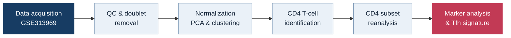
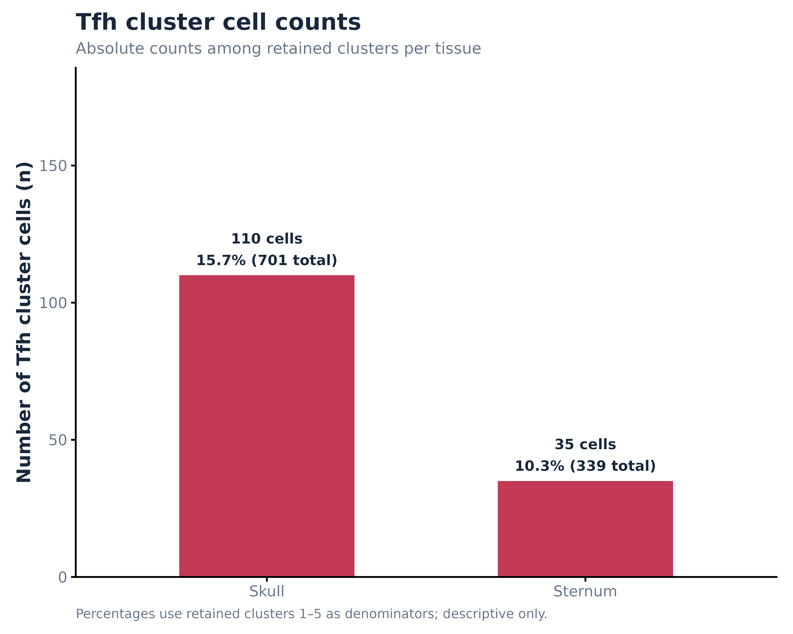

# Tfh-like Cell Populations in Skull and Sternum Bone Marrow

### Single-cell RNA-seq reanalysis | Mouse Bone Marrow | GSE313969

This repository contains computational results and poster-ready material from a reanalysis of published mouse skull and sternum bone marrow single-cell RNA-sequencing data.

The analysis focuses on identifying and characterizing a putative T follicular helper-like (Tfh-like) population within CD4-enriched T-cell populations.

Published B-cell findings from the original study are presented separately as supporting biological context.

---

# RESEARCH OBJECTIVE

To investigate whether skull bone marrow contains a distinct Tfh-like T-cell population and compare its transcriptional characteristics and representation with sternum bone marrow.

The findings are considered alongside published evidence of germinal-center-like B cells and antibody-secreting cells (ASCs) in skull bone marrow.

---

# METHODS

## Single-cell RNA-seq Reanalysis

Published mouse skull and sternum bone marrow scRNA-seq data (GSE313969) were reanalyzed using Seurat in R.

Following quality-control filtering and doublet removal, data were normalized, scaled, and subjected to principal component analysis (PCA) and graph-based clustering.

CD4-enriched T-cell populations were identified based on lineage-marker expression (*Cd3d⁺, Cd3e⁺, Cd4⁺, Cd8a⁻, Itgam⁻*) and subsetted for re-normalization, PCA, and reclustering.

Cluster-specific marker analysis and Tfh-associated signature scoring (*Pdcd1, Tox, Icos*) were used to characterize a putative Tfh-like population. Cell counts and proportions were compared between skull and sternum bone marrow.

## Computational Analysis Workflow

**Figure M.** Schematic representation of the computational workflow used to identify and characterize putative Tfh-like CD4 T-cell populations in mouse skull and sternum bone marrow.

**CD4 selection markers:** *Cd3d, Cd3e,* and *Cd4* expression, with low or absent *Cd8a* and *Itgam* expression.

---

# RESULTS

## 1. Identification and Distribution of CD4-Enriched T-cell Populations

| **A — Joint CD4 T-cell UMAP** | **B — UMAP Split by Tissue** |
|---|---|
| Joint UMAP visualization identified distinct transcriptional clusters within the retained CD4-enriched T-cell populations, including a putative Tfh-like cluster. | Tissue-split visualization using shared UMAP coordinates revealed the distribution of retained T-cell populations across skull (701 cells) and sternum (339 cells) bone marrow. |
|  |  |

**Figure A–B.** Joint and tissue-specific UMAP visualization of CD4-enriched T-cell populations from mouse skull and sternum bone marrow.

The joint embedding reveals transcriptionally distinct T-cell states, while tissue-specific visualization enables comparison of their distribution between the two bone marrow compartments.

---

## 2. Marker-Guided Identification of a Putative Tfh-like Population

### C | Tfh-Associated Marker Expression

Cluster-specific marker analysis revealed expression of *Pdcd1*, *Tox*, and *Icos* in the candidate Tfh-like population, supporting its provisional annotation.

Additional Tfh-associated markers, including *Cxcr5*, *Bcl6*, and *Il21*, were examined alongside regulatory T-cell markers such as *Foxp3*, *Il2ra*, and *Ctla4*.

  

**Figure C.** Expression of T-cell lineage, Tfh-associated, and regulatory T-cell markers across the original joint transcriptional clusters.

Dot size indicates the percentage of cells expressing each gene, while color represents scaled average expression.

The observed transcriptional profile supports a putative Tfh-like annotation but does not independently establish definitive Tfh cell identity.

---

## 3. Comparative Representation of Tfh-like Cells in Skull and Sternum BM

### D | Tfh-like Cluster Cell Counts

The putative Tfh-like cluster contained **110 cells in skull BM (15.7% of 701 retained cells)** compared with **35 cells in sternum BM (10.3% of 339 retained cells)**.

These findings indicate a higher observed representation of the Tfh-like cluster within the selected skull BM T-cell population.

  

**Figure D.** Absolute numbers of cells assigned to the putative Tfh-like cluster in skull and sternum bone marrow.

Percentages were calculated relative to the retained T-cell populations (clusters 1–5), rather than total bone marrow cells.

| Tissue | Retained T cells | Tfh-like cluster cells | Percentage |
|---|---:|---:|---:|
| Skull BM | 701 | 110 | 15.7% |
| Sternum BM | 339 | 35 | 10.3% |

*The comparison is descriptive. Biological-replicate-level statistical significance was not established.*

---

## 4. Published Evidence of B-cell Activation and Humoral Immunity

### E | Germinal-Center-Like B Cells and Experimental Validation

The original study, *Functional role of skull lymphoid structures in CNS immunosurveillance*, identified germinal-center-like (GC-like) B-cell populations and antibody-secreting cells (ASCs) in skull bone marrow.

Published B-cell scRNA-seq analysis revealed distinct developmental and activation-associated B-cell populations, including GC-like B cells, plasmablasts, and plasma cells.

Additional flow-cytometric experiments provided evidence for GC-like B-cell and antibody-secreting populations in skull bone marrow.

These published findings provide complementary biological context for the presence of a Tfh-associated T-cell compartment.

  

**Figure E.** Published B-cell transcriptional analysis and experimental validation supporting GC-like B-cell and antibody-secreting populations in skull bone marrow.

**Source:** Park et al., *Nature* (2026), Figure 2a–f.

[Functional role of skull lymphoid structures in CNS immunosurveillance](https://doi.org/10.1038/s41586-026-10951-4)

**Published evidence — not part of the present T-cell reanalysis.**

---

# KEY FINDING

Reanalysis of mouse skull and sternum bone marrow scRNA-seq data identified a CD4-enriched T-cell cluster displaying a putative Tfh-like transcriptional profile.

This cluster represented **15.7% of retained skull T cells versus 10.3% of retained sternum T cells**.

Published evidence of GC-like B cells and antibody-secreting cells provides a biological framework supporting the hypothesis that skull bone marrow may serve as a specialized site of adaptive humoral immune activity.

The observed tissue difference remains descriptive and requires biological-replicate-level validation.

---

# NOTES FOR POSTER DESIGNER

The following instructions are for poster preparation and do not need to appear in the scientific poster.

## Methods Layout

- Use the six-step computational workflow as a compact horizontal diagram.
- Place the Methods paragraph above or beside the diagram.
- Keep each workflow box concise and readable.
- Maintain a consistent Navy, Light Blue, and Crimson color palette.
- Allocate more space to the Results than to the Methods.
- QC and PCA elbow plots are not required in the main poster unless specifically requested.

## Results Layout

### Row 1 — Panels A and B

Display the Joint UMAP and Tissue-Split UMAP side by side.

- Maintain consistent cluster colors.
- Keep tissue names and cell numbers visible.
- Preserve the original plotted cell distributions.

### Row 2 — Panel C

Display the Marker DotPlot at full or near-full width.

- Keep marker names readable.
- Preserve the percentage-expression and average-expression legends.
- Ensure cell-population annotations are clearly visible.

### Row 3 — Panel D

Display the Tfh-like cluster cell-count bar chart independently.

- Preserve the absolute counts: 110 and 35 cells.
- Preserve the percentages: 15.7% and 10.3%.
- Do not introduce significance markers or p-values.

### Final Scientific Context — Panel E

Display the published B-cell and experimental-validation figure separately.

- Clearly indicate that this figure comes from the original study.
- Include the publication citation.
- Do not label it as a newly generated result.
- Check the original publication's image-reuse terms.

## Figure Labeling

| Panel | Title | Source |
|---|---|---|
| A | Joint CD4 T-cell UMAP | Present reanalysis |
| B | UMAP Split by Tissue | Present reanalysis |
| C | Tfh-Associated Marker Expression | Present reanalysis |
| D | Tfh-like Cluster Cell Counts | Present reanalysis |
| E | B-cell and Experimental Validation | Original publication |

**Important:** The continuous three-gene Tfh signature was calculated during analysis but is not displayed as a separate Results figure.

---

# ANALYSIS DETAILS AND REPRODUCIBILITY

The information below is intended for scientific documentation and should be verified against the original analysis scripts before final poster submission.

## Currently Reported Analysis Parameters

| Parameter | Reported setting |
|---|---|
| Organism | Mouse |
| Tissue sources | Skull and sternum bone marrow |
| GEO accession | GSE313969 |
| Analysis environment | R |
| Framework | Seurat |
| Mitochondrial-content cutoff | 8% |
| Principal components | PCs 1–15 |
| Clustering resolution | 0.6 |
| CD4 selection | Lineage-marker-guided subsetting |
| Candidate population | Putative Tfh-like cells |
| Signature genes | Pdcd1, Tox, Icos |
| Tissue comparison | Descriptive counts and proportions |

**Parameter verification required:** Confirm whether PCs 1–15 and resolution 0.6 apply to the initial clustering, the CD4-subset reclustering, or both.

Also confirm the exact mitochondrial filtering inequality and all additional QC settings.

## Details Requiring Confirmation

- R and Seurat versions.
- Exact mitochondrial filtering threshold and comparison operator.
- Additional gene-count and UMI-count QC thresholds.
- Doublet-detection package and parameters.
- Normalization method.
- Variable-feature selection and scaling procedure.
- PCA dimensions used at each clustering stage.
- Initial and subset reclustering resolutions.
- Any batch-correction or integration method used.
- Cluster-marker analysis function and parameters.
- Biological-replicate structure.
- Basis for retaining clusters 1–5.
- Confirmation of the cell counts used in all displayed figures.

---

# SCIENTIFIC INTERPRETATION NOTES

- The candidate Tfh-like population is identified through transcriptional markers, not functional assays.
- The three-gene signature is associated with the annotation markers and does not constitute independent validation.
- UMAP clustering does not demonstrate direct cell–cell communication.
- Cell counts are not independent biological replicates.
- The reported percentages reflect the retained T-cell populations rather than total bone marrow.
- Higher proportions among recovered cells do not establish increased absolute cell abundance in the original tissue.
- Published B-cell results provide independent biological context but do not directly validate the putative Tfh-like cluster.
- Functional conclusions concerning GC formation or antibody secretion require appropriate experimental evidence.

---

# FINAL POSTER CHECKLIST

- [ ] Confirm the exact QC filtering thresholds.
- [ ] Verify the doublet-detection method.
- [ ] Confirm PCA dimensions and clustering resolution.
- [ ] Verify that Figure A and B use shared UMAP coordinates.
- [ ] Check that all image filenames match their README references.
- [ ] Confirm the retained cluster identities and cell counts.
- [ ] Preserve the DotPlot color and size legends.
- [ ] Use "putative Tfh-like" consistently in the scientific interpretation.
- [ ] Do not report uncalculated p-values or statistical significance.
- [ ] Keep published B-cell evidence clearly separated.
- [ ] Verify the published figure attribution and reuse conditions.
- [ ] Remove designer-only and internal scientific notes from the final poster.

---

# REFERENCES

## Primary Publication

Park, J. H., et al. (2026).

*Functional role of skull lymphoid structures in CNS immunosurveillance.*

Nature.

https://doi.org/10.1038/s41586-026-10951-4

## Mouse T-cell scRNA-seq Dataset

**GEO Accession: GSE313969**

https://www.ncbi.nlm.nih.gov/geo/query/acc.cgi?acc=GSE313969

## Published Mouse B-cell Dataset — Reference Only

**GEO Accession: GSE309634**

https://www.ncbi.nlm.nih.gov/geo/query/acc.cgi?acc=GSE309634
