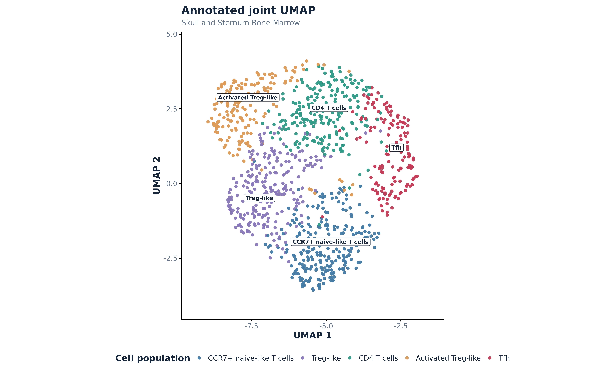
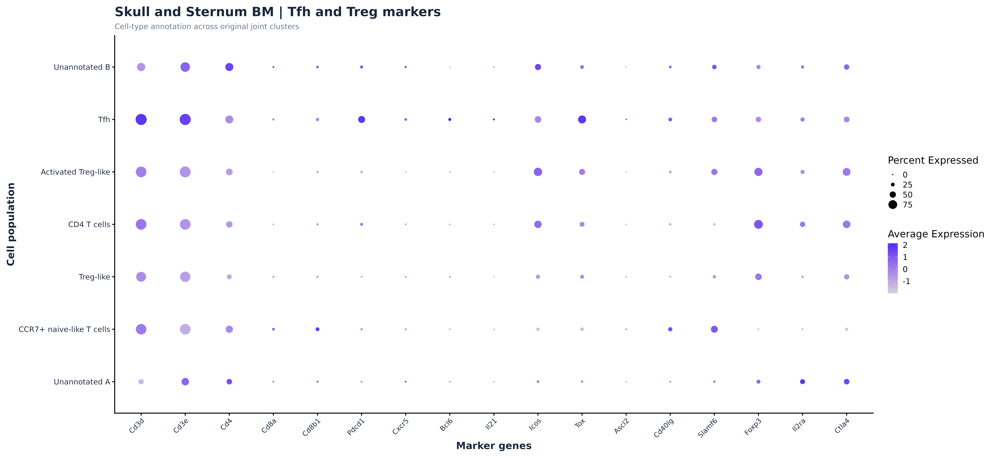

# Tfh-like Cell Populations in Skull and Sternum Bone Marrow

**Single-cell RNA-seq reanalysis | Mouse Bone Marrow | GSE313969**

## Research Objective

To investigate the presence and transcriptional characteristics of T follicular helper-like (Tfh-like) cells in mouse skull bone marrow and compare their distribution with sternum bone marrow.

This analysis also explores the relationship between Tfh-associated populations and published evidence of germinal-center-like B cells and antibody-secreting cells in skull bone marrow.

---

# METHODS

## Single-cell RNA-seq Reanalysis

Published mouse skull and sternum bone marrow scRNA-seq data (GSE313969) were reanalyzed using Seurat. Following quality-control filtering and doublet removal, data were normalized, scaled, and subjected to principal component analysis (PCA) and graph-based clustering.

CD4-enriched T-cell populations were identified based on lineage-marker expression (*Cd3d⁺, Cd3e⁺, Cd4⁺, Cd8a⁻, Itgam⁻*) and subsetted for re-normalization, PCA, and reclustering. Cluster-specific marker analysis and Tfh-associated signature scoring (*Pdcd1, Tox, Icos*) were then used to characterize a putative Tfh-like population and compare its distribution between skull and sternum bone marrow.

## Computational Analysis Workflow

**Figure M.** Schematic overview of the computational workflow used to identify and characterize putative Tfh-like CD4 T-cell populations in skull and sternum bone marrow.

---

# RESULTS

## 1. Identification and Distribution of CD4-Enriched T-cell Populations

<table>
<tr>
<td width="50%" valign="top">

### A | Joint CD4 T-cell UMAP

Joint visualization of skull and sternum CD4-enriched T-cell subsets identified distinct transcriptional clusters, including a putative Tfh-like population.

</td>
<td width="50%" valign="top">

### B | UMAP Split by Tissue

Tissue-split visualization using shared UMAP coordinates revealed the distribution of CD4-enriched T-cell populations across skull (701 cells) and sternum (339 cells) bone marrow.

</td>
</tr>
</table>

**Figure A–B.** Joint and tissue-specific UMAP visualization of CD4-enriched T-cell populations from mouse skull and sternum bone marrow.

---

## 2. Identification of Tfh-Associated Transcriptional Features

<table>
<tr>
<td width="50%" valign="top">

### C | Tfh-Associated Marker Expression

Marker analysis revealed expression of *Pdcd1*, *Tox*, and *Icos* in the candidate Tfh-like cluster. Additional Tfh- and Treg-associated markers were assessed to support provisional cell-state annotation.

</td>
<td width="50%" valign="top">

### D | Tfh-Associated Signature Score

A continuous Tfh-associated signature, calculated from the mean standardized expression of *Pdcd1*, *Tox*, and *Icos*, revealed heterogeneous transcriptional activity across the joint T-cell population.

</td>
</tr>
</table>

**Figure C–D.** Marker-expression patterns and a continuous three-gene Tfh-associated signature across the joint T-cell population.

### Tfh Signature Calculation

The continuous score was calculated using the mean gene-wise z-scored log-normalized expression:

**Tfh score = [Z(Pdcd1) + Z(Tox) + Z(Icos)] / 3**

The score reflects relative expression of the selected genes and does not independently establish definitive Tfh cell identity.

---

## 3. Comparative Abundance of Tfh-like Cells

### E | Tfh Cluster Cell Counts in Skull and Sternum BM

The putative Tfh-enriched cluster contained **110 cells in skull BM (15.7% of 701 selected cells)** compared with **35 cells in sternum BM (10.3% of 339 selected cells)**.

These findings indicate a higher descriptive abundance of the Tfh-like cluster within the selected skull BM T-cell population.

  

**Figure E.** Absolute counts of cells assigned to the putative Tfh-enriched cluster in skull and sternum bone marrow. Percentages are calculated relative to the selected T-cell populations, not total bone marrow cells.

*The comparison is descriptive; biological-replicate-level statistical significance was not established.*

---

## 4. Published Evidence of B-cell Activation and Humoral Immunity

### F | Germinal-Center-Like B Cells and Experimental Validation

The original study, *Functional role of skull lymphoid structures in CNS immunosurveillance*, identified germinal-center-like (GC-like) B cells and antibody-secreting cells (ASCs) in skull bone marrow.

Published B-cell scRNA-seq analysis revealed developmental and activation-associated B-cell populations, including GC-like B cells, plasmablasts, and plasma cells.

Additional flow-cytometry experiments provided complementary evidence for the presence of GC-like B-cell and antibody-secreting populations in skull bone marrow.

Together, these published findings support the involvement of skull bone marrow in local adaptive humoral immune responses.

  

**Figure F.** Published B-cell transcriptional analysis and experimental validation from the original study.

**Source:** Park et al., *Nature* (2026), Figure 2a–f.

[Functional role of skull lymphoid structures in CNS immunosurveillance](https://doi.org/10.1038/s41586-026-10951-4)

*This figure represents evidence from the original publication and is not a newly performed B-cell reanalysis in this project.*

---

# KEY FINDINGS

The single-cell reanalysis identified a putative Tfh-like transcriptional population in mouse skull and sternum bone marrow.

Within the selected T-cell subsets, the Tfh-like cluster exhibited a higher descriptive frequency in skull BM than in sternum BM (**15.7% vs. 10.3%**).

Expression of Tfh-associated markers and a continuous *Pdcd1–Tox–Icos* signature supported further characterization of this population.

Independent published evidence of GC-like B cells and antibody-secreting cells supports the hypothesis that skull bone marrow may serve as a specialized microenvironment for adaptive humoral immune activity.

---

# NOTES FOR POSTER DESIGN

## Methods

- Use the six-step workflow as a compact horizontal diagram.
- Keep the Methods paragraph short.
- Maintain consistent typography and colors.
- The Methods section should occupy less space than the Results.

## Results Arrangement

**Row 1:** Figures A and B side by side.

**Row 2:** Figures C and D side by side.

**Row 3:** Figure E as a standalone bar chart.

**Final subsection:** Figure F, clearly labeled as published B-cell and experimental validation.

## Scientific Notes

- Figures A–E belong to our T-cell scRNA-seq reanalysis.
- Figures A and B display selected T-cell clusters.
- Figure C includes all seven original joint clusters.
- Figure D displays the continuous signature across all 1,643 cells in the joint T-cell object.
- Figure E displays absolute cell counts with percentages among selected cells.
- Figure F is taken from the original publication and should retain its source attribution.
- Tfh-like annotations are provisional and based on transcriptional marker expression.
- Cell-level comparisons are descriptive and should not be interpreted as independent biological replicates.

---

# REFERENCES

**Primary Publication**

Park, J. H., et al. (2026). *Functional role of skull lymphoid structures in CNS immunosurveillance.* Nature.

https://doi.org/10.1038/s41586-026-10951-4

**Mouse T-cell scRNA-seq Dataset**

GEO Accession: **GSE313969**

https://www.ncbi.nlm.nih.gov/geo/query/acc.cgi?acc=GSE313969

**Published Mouse B-cell scRNA-seq Dataset**

GEO Accession: **GSE309634**

https://www.ncbi.nlm.nih.gov/geo/query/acc.cgi?acc=GSE309634
