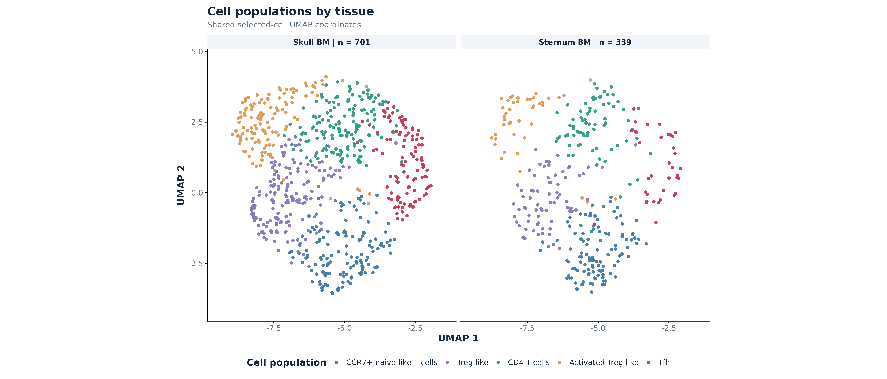

# Tfh-like Cell Populations in Skull and Sternum Bone Marrow

### Single-cell RNA-seq reanalysis | Mouse Bone Marrow | GSE313969

This repository contains computational results and poster-ready material from a reanalysis of published mouse skull and sternum bone marrow single-cell RNA-sequencing data.

The analysis focuses on identifying and characterizing a putative T follicular helper-like (Tfh-like) population within CD4-enriched T-cell populations.

Published B-cell findings from the original study are presented separately as supporting biological context.

---

# RESEARCH OBJECTIVE

To investigate whether skull bone marrow contains a distinct Tfh-like T-cell population and compare its transcriptional characteristics and representation with sternum bone marrow.

The findings are considered alongside published evidence of germinal-center-like B cells and antibody-secreting cells (ASCs) in skull bone marrow.

---

# METHODS

## Single-cell RNA-seq Reanalysis

Published mouse skull and sternum bone marrow scRNA-seq data (GSE313969) were reanalyzed using Seurat in R.

Following quality-control filtering and doublet removal, data were normalized, scaled, and subjected to principal component analysis (PCA) and graph-based clustering.

CD4-enriched T-cell populations were identified based on lineage-marker expression (*Cd3d⁺, Cd3e⁺, Cd4⁺, Cd8a⁻, Itgam⁻*) and subsetted for re-normalization, PCA, and reclustering.

Cluster-specific marker analysis and Tfh-associated signature scoring (*Pdcd1, Tox, Icos*) were used to characterize a putative Tfh-like population. Cell counts and proportions were compared between skull and sternum bone marrow.

## Computational Analysis Workflow

**Figure M.** Schematic representation of the computational workflow used to identify and characterize putative Tfh-like CD4 T-cell populations in mouse skull and sternum bone marrow.

**CD4 selection markers:** *Cd3d, Cd3e,* and *Cd4* expression, with low or absent *Cd8a* and *Itgam* expression.

---

# RESULTS

## 1. Identification and Distribution of CD4-Enriched T-cell Populations

| **A — Joint CD4 T-cell UMAP** | **B — UMAP Split by Tissue** |
|---|---|
| Joint UMAP visualization identified distinct transcriptional clusters within the retained CD4-enriched T-cell populations, including a putative Tfh-like cluster. | Tissue-split visualization using shared UMAP coordinates revealed the distribution of retained T-cell populations across skull (701 cells) and sternum (339 cells) bone marrow. |
|  |  |

**Figure A–B.** Joint and tissue-specific UMAP visualization of CD4-enriched T-cell populations from mouse skull and sternum bone marrow.

The joint embedding reveals transcriptionally distinct T-cell states, while tissue-specific visualization enables comparison of their distribution between the two bone marrow compartments.

---

## 2. Marker-Guided Identification of a Putative Tfh-like Population

### C | Tfh-Associated Marker Expression

Cluster-specific marker analysis revealed expression of *Pdcd1*, *Tox*, and *Icos* in the candidate Tfh-like population, supporting its provisional annotation.

Additional Tfh-associated markers, including *Cxcr5*, *Bcl6*, and *Il21*, were examined alongside regulatory T-cell markers such as *Foxp3*, *Il2ra*, and *Ctla4*.

  

**Figure C.** Expression of T-cell lineage, Tfh-associated, and regulatory T-cell markers across the original joint transcriptional clusters.

Dot size indicates the percentage of cells expressing each gene, while color represents scaled average expression.

The observed transcriptional profile supports a putative Tfh-like annotation but does not independently establish definitive Tfh cell identity.

---

## 3. Comparative Representation of Tfh-like Cells in Skull and Sternum BM

### D | Tfh-like Cluster Cell Counts

The putative Tfh-like cluster contained **110 cells in skull BM (15.7% of 701 retained cells)** compared with **35 cells in sternum BM (10.3% of 339 retained cells)**.

These findings indicate a higher observed representation of the Tfh-like cluster within the selected skull BM T-cell population.

  

**Figure D.** Absolute numbers of cells assigned to the putative Tfh-like cluster in skull and sternum bone marrow.

Percentages were calculated relative to the retained T-cell populations (clusters 1–5), rather than total bone marrow cells.

| Tissue | Retained T cells | Tfh-like cluster cells | Percentage |
|---|---:|---:|---:|
| Skull BM | 701 | 110 | 15.7% |
| Sternum BM | 339 | 35 | 10.3% |

*The comparison is descriptive. Biological-replicate-level statistical significance was not established.*

---

## 4. Published Evidence of B-cell Activation and Humoral Immunity

### E | Germinal-Center-Like B Cells and Experimental Validation

The original study, *Functional role of skull lymphoid structures in CNS immunosurveillance*, identified germinal-center-like (GC-like) B-cell populations and antibody-secreting cells (ASCs) in skull bone marrow.

Published B-cell scRNA-seq analysis revealed distinct developmental and activation-associated B-cell populations, including GC-like B cells, plasmablasts, and plasma cells.

Additional flow-cytometric experiments provided evidence for GC-like B-cell and antibody-secreting populations in skull bone marrow.

These published findings provide complementary biological context for the presence of a Tfh-associated T-cell compartment.

  

**Figure E.** Published B-cell transcriptional analysis and experimental validation supporting GC-like B-cell and antibody-secreting populations in skull bone marrow.

**Source:** Park et al., *Nature* (2026), Figure 2a–f.

[Functional role of skull lymphoid structures in CNS immunosurveillance](https://doi.org/10.1038/s41586-026-10951-4)

**Published evidence — not part of the present T-cell reanalysis.**

---
