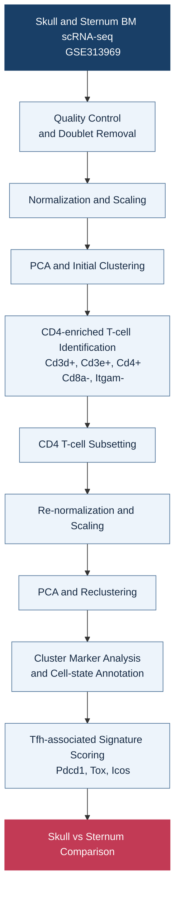
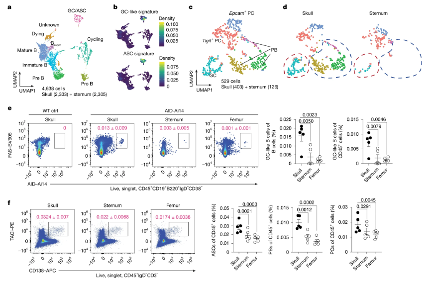

# Tfh-like Cell Populations in Skull and Sternum Bone Marrow

### Single-cell RNA-seq reanalysis | Mouse bone marrow | GSE313969

## Research Objective

To investigate the presence and transcriptional characteristics of T follicular helper-like (Tfh-like) cells in mouse skull bone marrow and compare their distribution with sternum bone marrow.

The analysis also explores how these findings relate to published evidence of germinal-center-like B cells and antibody-secreting cells in skull bone marrow.

---

# Methods

### Single-cell RNA-seq reanalysis

Published mouse skull and sternum bone marrow scRNA-seq data (GSE313969) were reanalyzed using Seurat. Following quality-control filtering and doublet removal, CD4-enriched T-cell populations were identified and subjected to subset-specific reclustering, marker analysis, and Tfh-associated signature scoring.

### Computational Analysis Workflow

**Figure M.** Schematic overview of the computational workflow used to identify and characterize putative Tfh-like CD4 T-cell populations in skull and sternum bone marrow.

---

# Results

## 1. Identification and Distribution of CD4-Enriched T-cell Populations

| **A — Joint CD4 T-cell UMAP** | **B — UMAP Split by Tissue** |
|:---:|:---:|
| Joint visualization of skull and sternum CD4-enriched T-cell populations identified distinct transcriptional clusters, including a putative Tfh-like population. | Tissue-split visualization using shared UMAP coordinates revealed the distribution of CD4-enriched T-cell populations across skull (701 cells) and sternum (339 cells) bone marrow. |
|  |  |

---

## 2. Identification of Tfh-Associated Transcriptional Features

| **C — Tfh-associated Marker Expression** | **D — Tfh-associated Signature Score** |
|:---:|:---:|
| Marker analysis revealed expression of *Pdcd1*, *Tox*, and *Icos* in the candidate Tfh-like cluster. Additional Tfh- and Treg-associated markers were assessed to support provisional cell-state annotation. | A continuous Tfh-associated signature, calculated from the mean standardized expression of *Pdcd1*, *Tox*, and *Icos*, revealed heterogeneous transcriptional activity across the joint T-cell population. |
|  |  |

**Signature calculation**

The continuous Tfh-associated score was calculated as the average of gene-wise standardized log-normalized expression:

**Tfh score = [Z(Pdcd1) + Z(Tox) + Z(Icos)] / 3**

This signature represents relative expression of the selected genes rather than definitive Tfh identity.

---

## 3. Comparative Abundance of the Tfh-like Cluster

### E — Tfh Cluster Cell Counts in Skull and Sternum BM

The putative Tfh-enriched cluster contained **110 cells in skull BM (15.7% of 701 selected cells)** compared with **35 cells in sternum BM (10.3% of 339 selected cells)**.

These results indicate a higher descriptive abundance of the Tfh-like cluster within the selected skull BM T-cell population.

**Figure E.** Absolute counts of cells assigned to the putative Tfh cluster in skull and sternum bone marrow. Percentages are calculated relative to the selected T-cell populations, rather than total bone marrow cells.

*The comparison is descriptive; biological-replicate-level statistical significance was not established.*

---

## 4. Published Evidence of Germinal-Center-like B Cells and Antibody-Secreting Cells

### F — B-cell Populations and Experimental Validation

The original study, *Functional role of skull lymphoid structures in CNS immunosurveillance*, identified germinal-center-like (GC-like) B-cell populations and antibody-secreting cells (ASCs) in skull bone marrow.

The published B-cell scRNA-seq analysis revealed distinct developmental and activation-associated B-cell populations, including GC/ASC-associated cells.

Additional flow-cytometric analyses supported the presence of GC-like B cells and antibody-secreting populations in skull bone marrow.

Together, these published findings provide complementary evidence supporting the involvement of skull bone marrow in local adaptive humoral immune responses.

**Figure F.** Published B-cell transcriptional analysis and experimental validation. Reproduced from Park et al., *Nature* (2026), Figure 2a–f. This figure represents evidence from the original publication, not a newly performed B-cell reanalysis in this project.

**Source:** [Functional role of skull lymphoid structures in CNS immunosurveillance](https://doi.org/10.1038/s41586-026-10951-4)

---

# Key Findings

The single-cell reanalysis identified a putative Tfh-like transcriptional population in mouse skull and sternum bone marrow.

Within the selected T-cell populations, the Tfh-like cluster showed a higher descriptive frequency in skull BM than in sternum BM (15.7% versus 10.3%).

Expression of Tfh-associated markers and a continuous *Pdcd1–Tox–Icos* signature supported further characterization of this population.

Independent published evidence of GC-like B cells and ASCs suggests that skull bone marrow may provide a specialized microenvironment supporting adaptive humoral immune responses.

---

# Important Notes

- The T-cell UMAPs, marker DotPlot, signature analysis, and cell counts represent the computational reanalysis.
- Figures A and B display selected T-cell clusters, while Figure C includes all original joint clusters.
- Figure D displays the continuous signature across the full joint T-cell population.
- Figure E reports absolute Tfh-cluster cell counts and percentages among selected cells.
- Figure F is taken from the original publication and is presented as complementary published evidence.
- Cell-type annotations are marker-guided and provisional.
- Cell-level counts should not be interpreted as independent biological replicates.

---

# References

**Primary publication**

Park, J. H., et al. (2026). *Functional role of skull lymphoid structures in CNS immunosurveillance.* Nature.

https://doi.org/10.1038/s41586-026-10951-4

**Mouse T-cell scRNA-seq dataset**

GEO accession: **GSE313969**

https://www.ncbi.nlm.nih.gov/geo/query/acc.cgi?acc=GSE313969

**Published B-cell scRNA-seq dataset**

GEO accession: **GSE309634**

https://www.ncbi.nlm.nih.gov/geo/query/acc.cgi?acc=GSE309634
